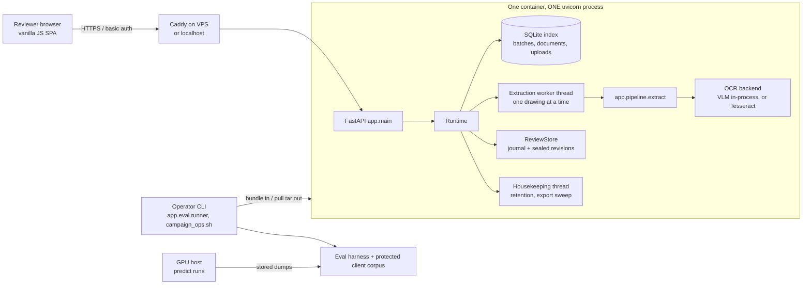

# Architecture

Last synced against the code: 2026-11-22 (`main` @ `82c7cf6`).

This is the entry point for architecture questions. It says what the pieces are, how
data moves, and **why the system has this shape**. It does not repeat measurements or
decision write-ups: each "why" links to the plan/design doc that holds the evidence
(ADRs in `docs/adr/`, evidence in `docs/plans/`, one entry per run in `EXPERIMENTS.md`). Operating rules for the
client corpus are in `CLAUDE.md` §1 and `docs/eval/DATA-HANDLING.md`; the product
direction is in `ROADMAP.md`.

## Overview

Sindri auto-balloons engineering drawings. A vision-language model (VLM) finds the
inspection characteristics on a PDF drawing, reads their values, and numbers and places
balloons. A person then reviews the result in a web UI (move, add, delete, correct),
and finishing the review exports the client's Excel inspection sheet plus a ballooned PDF.

Two facts shape almost everything else:

1. **The client ranks precision over recall.** Every value delivered *unflagged* must be
   true. So the pipeline's job is not "find everything" but "know what it is unsure of":
   it flags or withholds uncertain rows, and the review UI is built to make a human
   resolve exactly those.
2. **Quality is measured as expected reviewer effort**, not accuracy, against client-supplied
   gold. That needs a separate measurement harness, and a way to measure what real
   reviewers change (the review campaign), under an NDA that forbids agents seeing the data.

The system is therefore four loosely coupled parts around one data contract:

| Part | Directory | Role |
|---|---|---|
| Pipeline | `app/pipeline/` | Drawing PDF → proposed rows (the product) |
| Review product | `app/batch/`, `app/review/`, `app/campaign/`, `app/main.py`, `app/static/` | Queue, background extraction, durable review, export |
| Eval harness | `app/eval/` | Scores pipeline output and reviewer behaviour; never part of the served app |
| Training | `app/train/`, `train_lora.py`, `merge_lora.py` | Read-adapter experiments (deployment currently closed) |

## System context

## Components

### Pipeline (`app/pipeline/`)
Entry point: `extract.extract()` (`app/pipeline/extract.py`).

- `render.py` renders page 1 at a dpi clamped to a pixel budget; `render.scale` is the
  only valid box-to-PDF scale and is carried everywhere.
- `detect.py` tiles the page and asks the VLM for regions (stage 1: localise).
  `boxes.py` tightens boxes to ink and does CV frame handling.
- `extract.py` crops each box (with context padding) and has the VLM read it (stage 2:
  transcribe), with a rotation retry. `parser.py` turns text into
  `char_type / nominal / upper_tol / lower_tol`.
- Side channels: `notes_block.py` / `marks_block.py` (notes legend), `title_block.py`
  (title-block fields). These regions are masked out before detection so their text is
  not misread as dimensions.
- `review.py` + `policy_rules.py` assign review flags and apply **drop rules**. Flags
  precede drops; drops run in *stages*. Stage-2 drops go to `ExtractionResult.suggestions`
  (the "suggestion tray"), not `characteristics`, so a dropped value is never lost.
- `place.py` numbers rows in reading order and places balloons; `ballooned_pdf.py`
  draws them.
- `ocr/` holds the backends behind one `OCRBackend` protocol (`ocr/__init__.get_backend`
  picks by `OCR_BACKEND`): `vlm_backend` (transformers; AWQ/NF4/adapter), `vllm_backend`,
  `hybrid_backend` (two models), and `tesseract_backend` (CPU fallback and the default in
  the plain container; it cannot detect, so it serves `read_region` only — ADR 0012). A failed GPU load falls back to Tesseract *loudly*, recording the
  reason on `/api/health`.
- `app/models.py` is the contract: `Characteristic`, `ExtractionResult` (rows, suggestions,
  notes, marks, title block). `Confidence` guards NaN at the model boundary.

### Batch / queue (`app/batch/`)
Product code; a boundary test forbids importing `app.eval`.

- `runtime.Runtime` wires data dir, SQLite index (`db.py`, numbered append-only
  migrations, WAL), `repo.Repo` (state machine: staged → queued → extracting → ready →
  in_review → finished, plus failed/cancelled/purged), `uploads.py` (chunked, resumable
  upload protocol), `staging.py`/`unzip.py`/`pdf_facts.py` (draft batches, ZIP unpack,
  scope flags), `worker.Worker` (single extraction thread), `exports.py` +
  `export_render.py` (mass-export ZIPs on their own thread; one shared render path with
  single-document export), `housekeeping.py` (retention, export-ZIP sweep).
- `paths.DataDir` owns the on-disk layout under `SINDRI_DATA_DIR`.

### Review records (`app/review/`)
- `store.ReviewStore` is the durable, server-held record per session:
  `header.json` (config the proposal was made under), `proposal.json` (never
  client-supplied), `events.jsonl` (reviewer operations), `sealed/rN.json`.
- `journal.py` defines the event vocabulary and validation; `replay.py` replays net
  events on the proposal and **mirrors `app/static/js/state.js` op by op**
  (`tests/review/test_journal_replay_parity.py` fuzzes the contract).
- `grading.py` grades a sealed review against its proposal (confirmed / edited /
  phantom / suggestion_* / missed). It is product code so in-house review can reuse it.
- `header.py` builds the configuration fingerprint.

### Campaign (`app/campaign/`)
A *campaign* is a batch with `batch.campaign` set: drawings loaded from stored
prediction dumps instead of extracted live, reviewed and *approved* (sealed, never
exported), then pulled into the protected root. `load.py` (validating, idempotent loader),
`pull.py` (durable tar pack), `policy.py` (`SINDRI_CAMPAIGN_ONLY` positive allowlist of
routes, scoping reads to campaign batches, rate limit on `read_region`).

### HTTP API and UI (`app/main.py`, `app/auth.py`, `app/static/`)
- FastAPI app, one module. Routes: batches/uploads/documents, `open` (rebuild review from
  the journal with a fresh writer token), `session/{id}/events|seal`, `image`, exports,
  `read_region` (rescan a user-drawn rectangle), `health`. Optional shared token
  (`SINDRI_ACCESS_TOKEN`) via cookie, no `Secure` flag on purpose (plain-HTTP LAN is supported).
- Front end is **dependency-free ES modules** in `app/static/js/`, hash-routed
  (`#/`, `#/staging/<batch>`, `#/doc/<id>`; `router.js`). Pure UI rules (`state.js`,
  `reviewbar.js`, `banner.js`, `reasons.js`, …) are node-tested from pytest; real-browser
  tests live in `tests/browser/`.
- `app/excel.py` writes the client's Excel format.

### Eval harness (`app/eval/`)
CLI `python -m app.eval.runner <probe|headers|ingest|split|predict|verify|score|compare|summary|variants>`
plus operator-only `review-serve`, `review-tally`, `campaign-deck`.

- `ingest` builds gold from client Excel + stamped drawings (frame fixed with `--originals`);
  `splits.py` freezes train/dev/test; `predict` runs the pipeline on a GPU host and writes
  dumps; `score` matches predictions to gold (`matching.py`), prices errors with
  `ReviewCostWeights` (`eval/models.py`; `--weights docs/eval/weights.json` holds the same
  values), writes a client-value report; `summary`/`compare` emit **counts-only
  digests** committed under `docs/eval/`.
- `reapply.py`, `policy_check.py`, `reparse.py`, `drop_check.py` re-price a rule or parser
  change from stored dumps in CPU seconds. `campaign_grade.py` grades reviewer behaviour
  (`score --reviewer-grade`).
- `outputs.py` is the single hardened writer for every `--out` flag; `anon.py` salts doc ids.

## Data flow

**1. Live extraction (regular use).**
Browser uploads (chunked) → draft batch + staged documents → `POST /batches/{id}/start`
queues → `Worker` picks one → `extract()` → `result.json` in the drawing's data dir, then
`proposal.json` + `header.json` in the review dir → document `ready`.

**2. Review.**
`POST /documents/{id}/open` rebuilds state from `proposal.json` + journal and issues a
writer token (latest tab wins) → UI appends net operations to `events.jsonl` → **Finish**
replays the journal on the server-held proposal, seals `sealed/rN.json` → exports are
rendered *server-side from the sealed revision only* (single or mass ZIP + `manifest.csv`).

**3. Campaign (client pilot).**
Operator: `campaign_build.py` (re-applies today's policy to stored dumps, re-places
balloons) → bundle → `campaign_ops.sh` (`local-up` / `vps-load`) → `app.campaign.load`
→ reviewer Approves (seal, no export) → `pull` tar → `score --reviewer-grade` → counts-only
digest in `docs/eval/`.

**4. Measurement.**
`predict` (GPU host, resumable) → dumps → `score` against gold → report (client values,
protected root) → `summary` (digest, safe to commit).

## Why it is designed this way

| Design choice | Reason | Deeper doc |
|---|---|---|
| Two-stage VLM (detect, then crop-and-read) | Box framing dominates read accuracy; the crop context pad is a recorded, tuned knob | [ADR 0008](docs/adr/0008-two-stage-vlm-detect-then-read-with-crop-context.md) |
| Flag and drop by gold-free policy rules, in stages | Review cost and delivered precision improve only by converting *silent* errors to flagged ones; each stage was priced on what the previous left | [ADR 0003](docs/adr/0003-flag-and-drop-by-gold-free-policy-stages.md) |
| Suggestion tray instead of deleting drops | A dropped value may be right; the reviewer can still confirm it, but it is never exported unconfirmed | [ADR 0009](docs/adr/0009-suggestion-tray-for-dropped-rows.md) |
| `app/pipeline` and `app/eval` kept apart | Eval must not import internals that move under tuning; the batch/review product must not import eval | [ADR 0006](docs/adr/0006-pipeline-and-eval-kept-separate.md) |
| Server-held proposal + append-only journal + sealed revisions | Reviews are the measurement instrument; the client must never be able to alter what was proposed, and a crashed tab must lose nothing | [ADR 0002](docs/adr/0002-journal-and-sealed-revisions-as-source-of-truth.md) |
| Journal is mandatory, exports only from sealed revision | An unrecorded review would ship ungradable; exports must be reproducible from the record | [ADR 0002](docs/adr/0002-journal-and-sealed-revisions-as-source-of-truth.md) |
| Extraction in a background worker, one drawing at a time, SQLite index | One GPU-bound model; browser-detached work; durable queue without extra services | [ADR 0001](docs/adr/0001-single-process-worker-with-sqlite-index.md) |
| **Exactly one uvicorn process** | The worker lock, import recovery and housekeeping assume a single process (enforced by a lock file) | [ADR 0001](docs/adr/0001-single-process-worker-with-sqlite-index.md) |
| Chunked, resumable uploads | Large drawing sets over flaky links; completion hashes the file, duplicates detected by SHA-256 | [ADR 0010](docs/adr/0010-chunked-resumable-upload-protocol.md) |
| Replay logic duplicated in JS and Python | UI must be instant; server must be able to re-derive the seal. Drift is caught by a fuzz test, not by sharing code | [ADR 0004](docs/adr/0004-replay-implemented-twice-in-js-and-python.md) |
| Campaign-only mode as a *positive allowlist* | The public host serves one client's drawings; a new route must stay closed until classified | [ADR 0005](docs/adr/0005-campaign-only-positive-allowlist.md) |
| Grading is client-primary, gold only a cross-check | The sealed review is the truth; gold covers a subset of what the client inspects | [C2 grading design](docs/plans/2026-10-22-campaign-c2-grading-design.md) |
| Digests are counts-only; client-value files only in the protected root | The corpus is under NDA and agents are guarded; every `--out` flag is validated by the CLI itself | [ADR 0007](docs/adr/0007-counts-only-digests-and-hardened-outputs.md) |
| Scope: single-sheet drawings at a size the renderer handles | Other sheets are unrecoverable misses; scope is explicit and recorded in reports | [ADR 0011](docs/adr/0011-single-sheet-supported-size-scope-policy.md) |
| VLM required for extraction; Tesseract is a loud CPU fallback | The image must boot without a GPU (CI, campaign VPS), but Tesseract cannot detect, so a GPU failure must announce itself rather than degrade silently | [ADR 0012](docs/adr/0012-vlm-required-for-extraction-tesseract-as-loud-fallback.md) |

## External integrations

- **VLM weights** (Qwen2.5-VL family via Hugging Face; AWQ 72B in production config) —
  loaded in-process by `ocr/vlm_backend` or `vllm_backend`.
- **Tesseract** (system binary, `eng`+`deu`) — fallback OCR; a device prerequisite for tests.
- **PyMuPDF (fitz)** — render, PDF facts, ballooned PDF output.
- **GPU host** — runs `predict`/`train` only (`run_gpu_queue.sh`, `Dockerfile.gpu`, vLLM/quant
  images). It cannot fetch from GitHub; code arrives by push. It mints its own doc-id salt.
- **Caddy** — TLS and basic auth in front of the VPS app.
- **Client corpus** — `~/sindri-client-data`, outside the repo, guarded by hooks.

## Deployment topology

- **Container**: `Dockerfile` (CPU, Tesseract) or `Dockerfile.gpu` (VLM) via
  `docker-compose.yml` [+ `docker-compose.gpu.yml`]. State lives in one volume
  (`SINDRI_DATA_DIR`, review records in `SINDRI_REVIEW_DIR`); nothing client-related in the image.
- **Campaign VPS** (Hetzner): `docker-compose.vps.yml` binds `127.0.0.1:8000`, sets
  `SINDRI_CAMPAIGN_ONLY=1` and retention off; Caddy is the only way in
  (`deploy/Caddyfile.example`). Runbook: `docs/deploy/vps.md`. Until a VPS exists,
  `campaign_ops.sh local-up` runs the identical mode locally.
- **Eval/GPU**: operator pushes code to the GPU host, runs queues in tmux there, pulls dumps
  back, scores locally.

Key configuration: `OCR_BACKEND`, `VLM_MODEL_ID`, `SINDRI_DATA_DIR` (must be set for local
dev), `SINDRI_REVIEW_DIR`, `SINDRI_ACCESS_TOKEN`, `SINDRI_CAMPAIGN_ONLY`,
`SINDRI_RETENTION_DAYS`, `SINDRI_MIN_FREE_MB`, `SINDRI_CROP_PAD`.

## Investigating: where to start

| Question | Start at |
|---|---|
| Why was a row flagged or dropped? | `pipeline/policy_rules.py`, `pipeline/review.py`, `extract._apply_active_policy` |
| A review state looks wrong / seal mismatch | `review/replay.py` vs `static/js/state.js`, `review/store.py` |
| A drawing is stuck or failed | `batch/worker.py`, `batch/repo.py` transitions, `/api/health` |
| Import / upload problems | `batch/uploads.py`, `batch/staging.py` |
| What does the public host allow? | `campaign/policy.py` (and `tests/campaign/test_policy.py`) |
| How is quality measured? | `eval/score.py`, `eval/matching.py`, `eval/experiment.py`, `docs/eval/*-summary.json` |
| Current state and next steps | `ROADMAP.md`, newest `docs/plans/*-session-handoff.md` |

## Known deviations / tech debt

- **ADRs are retroactive.** `docs/adr/0001`–`0012` were written after the fact from the
  design/plan/result docs in `docs/plans/` (index: `docs/adr/README.md`). Every row of the
  "why" table links to one. New decisions should get an ADR when made.
- **Tesseract cannot extract.** It has no `detect_regions`, so `extract()` refuses it
  (ADR 0012); it serves `read_region` and tests only. The plain `docker compose up`
  image is therefore a review/campaign host, not a live-extraction host (the README now
  says so).
- **Closed experiments still in the tree**: `hybrid_backend`, adapter/LoRA paths in
  `vlm_backend`, `app/train/`, `merge_lora.py`, `verifier.py`. Kept for reproducibility;
  deploying the read adapter is closed under the shipped policy (`CLAUDE.md` §3).
- **Two front doors for the same pipeline**: live extraction and campaign load share the
  worker but differ in whether `result.json` already exists; campaign drawings refuse
  export, re-extract and remove everywhere.
- `CLAUDE.md` §2 is an accreting chronological log; this file is the structural summary and
  does not replace its measurements.
